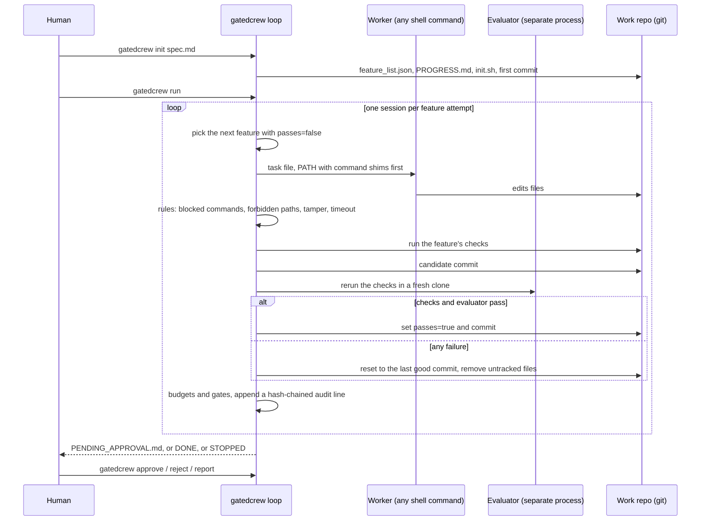

# gatedcrew

[](https://github.com/shreyas-tech7/shiftlog/actions/workflows/ci.yml)

**Status:** release candidate v0.1.0-rc1. Private repo. The working title was `shiftlog`. The package and command are `gatedcrew`, because `shiftlog` is taken on npm.

gatedcrew runs a coding agent in short, logged sessions under written rules for budgets and approvals. A long unattended run stays safe to leave and easy to review in the morning.

> **What the benchmark measures.** The benchmark injects scripted faults into a fake worker. It measures how the harness reacts to those faults, not how good any model is. No model ran in any result on this page.

## The problem

Anthropic describes three ways long-running agents fail ([effective harnesses](https://anthropic.com/engineering/effective-harnesses-for-long-running-agents), [harness design](https://anthropic.com/engineering/harness-design-long-running-apps)). They wrap up early. They lose track as the context fills. They praise their own work. Their posts also show the cost of getting it wrong: one full multi-agent harness ran for 6 hours and cost $200, against 20 minutes and $9 for a solo run.

If you let an agent run overnight, you want three things. A run that stops when something goes wrong. A log you can trust. And a pass that means the work really passes, not that the agent said so.

gatedcrew is a small guardrail layer for that. It follows Anthropic's pattern of an initializer session plus short coding sessions, and it keeps the grader apart from the worker.

## How it works



The loop is a state machine with an explicit table in [`src/gatedcrew/machine.py`](src/gatedcrew/machine.py). Each row has a test.

## Results

<!-- headline:start -->
Setup: 30 specs, 114 features, seeds 1 and 2. Headline (scripted faults, fake worker). Seed 1: 97.4% of features truly done with the evaluator against 87.7% without it (12 false passes without, 0 with). Seed 2: 97.4% of features truly done with the evaluator against 73.7% without it (29 false passes without, 0 with).
<!-- headline:end -->

Each spec runs twice on the same seeded fault plan: once with the separate evaluator and once without it. "Done (true)" reruns every check in a clean clone of the final commit. "Claimed" counts the `passes` flags. A false pass is a flag that the clean rerun does not back up. The 95% intervals come from a bootstrap over specs (2,000 resamples). They show how much the numbers move with the draw of scripted faults. They say nothing about any model.

<!-- results:start -->
| Seed | Arm | Features done (true) | 95% interval | Claimed done | False passes | Sessions | Wasted sessions | Wasted per spec (95% interval) |
| ---: | --- | ---: | --- | ---: | ---: | ---: | ---: | --- |
| 1 | with evaluator | 97.4% | 93.2% to 100.0% | 97.4% | 0 | 184 | 73 | 2.43 (1.93 to 3.00) |
| 1 | without evaluator | 87.7% | 81.6% to 93.3% | 98.2% | 12 | 170 | 58 | 1.93 (1.50 to 2.40) |
| 2 | with evaluator | 97.4% | 94.5% to 100.0% | 97.4% | 0 | 213 | 102 | 3.40 (2.77 to 4.07) |
| 2 | without evaluator | 73.7% | 67.0% to 80.0% | 99.1% | 29 | 177 | 64 | 2.13 (1.63 to 2.67) |

Gate triggers, summed over 30 specs. These are fixed counts for each seed, with no sampling interval.

| Seed | Arm | forbidden_command | network | forbidden_path | evaluator_disagrees | failed_twice | budget_tokens | budget_sessions |
| ---: | --- | ---: | ---: | ---: | ---: | ---: | ---: | ---: |
| 1 | with evaluator | 6 | 7 | 14 | 13 | 4 | 1 | 0 |
| 1 | without evaluator | 6 | 7 | 14 | 0 | 4 | 1 | 0 |
| 2 | with evaluator | 8 | 3 | 7 | 32 | 13 | 2 | 0 |
| 2 | without evaluator | 8 | 3 | 7 | 0 | 11 | 2 | 0 |

Source: `results/bench-seed1.json`, `results/bench-seed2.json`. Seed 1: 2026-11-20, none (scripted fake worker), Intel(R) Xeon(R) Processor @ 2.10GHz, 1 core, 70.8 s. Seed 2: 2026-11-20, none (scripted fake worker), Intel(R) Xeon(R) Processor @ 2.10GHz, 1 core, 106.5 s.
<!-- results:end -->

What this shows. Without the evaluator, a worker that leans on a git-ignored helper file passes its own checks and gets a `passes` flag it did not earn. With the evaluator, that same fault fires a gate, the session is reverted, and the next honest attempt passes. The evaluator costs more sessions and more wall time. It buys flags that hold up.

## Cost per task

The fake worker reports synthetic token counts. The token column leaves out the token burn fault sessions, which report a huge count on purpose to trip the budget. No money was spent. Wall time is real, measured on the build VM.

<!-- cost:start -->
| Seed | Arm | Sessions per finished feature | Reported tokens per finished feature | Wall seconds per spec | Money spent |
| ---: | --- | ---: | ---: | ---: | ---: |
| 1 | with evaluator | 1.66 | 9,011,482 | 1.34 | $0 |
| 1 | without evaluator | 1.70 | 10,002,535 | 0.76 | $0 |
| 2 | with evaluator | 1.92 | 18,020,869 | 2.02 | $0 |
| 2 | without evaluator | 2.11 | 23,812,649 | 1.22 | $0 |
<!-- cost:end -->

## Run it in 10 minutes

You need Python 3.11 or newer, git and [uv](https://docs.astral.sh/uv/) (or plain `venv`).

```bash
git clone https://github.com/shreyas-tech7/shiftlog.git && cd shiftlog
./init.sh                      # venv, install, lint, link check, all tests offline
source .venv/bin/activate

# 1. Make a work repo from a plain spec
gatedcrew init examples/tiny-calc.md --work /tmp/calc

# 2. Run the scripted fake worker. It tries a forbidden git push first.
gatedcrew run --work /tmp/calc --worker "gatedcrew fake-worker --script $PWD/examples/tiny-calc-script.json"
cat /tmp/calc/PENDING_APPROVAL.md

# 3. Decide, then go on
gatedcrew approve --work /tmp/calc --note "push was blocked, fine"
gatedcrew run --work /tmp/calc --worker "gatedcrew fake-worker --script $PWD/examples/tiny-calc-script.json"

# 4. Read the morning report and check the log
gatedcrew report --work /tmp/calc
gatedcrew verify --work /tmp/calc

# 5. The benchmark (a few minutes per seed)
gatedcrew bench --seed 1 --out /tmp/bench-seed1.json
```

The full transcript of steps 1 to 4 is in [docs/DEMO.md](docs/DEMO.md). A static results page is in [docs/index.html](docs/index.html). It opens from disk.

To use your own worker, pass any shell command as `--worker`. It runs in the work repo. It finds its task in the file named by `$GATEDCREW_TASK` and may report usage as JSON (`{"tokens": 1234, "cost_usd": 0.01}`) to `$GATEDCREW_USAGE`. Rules live in a `policy.toml`. See [examples/policy.toml](examples/policy.toml).

### What each gate does

| Gate | Fires when | Stops this failure |
| --- | --- | --- |
| `forbidden_command` | the worker runs a listed command, such as `git push` or `git commit` | pushing, rewriting history, changing git config |
| `network` | the worker runs `curl`, `wget`, `ssh` and the like while the policy allows no network | leaking code, pulling in unknown scripts |
| `forbidden_path` | the worker changes `feature_list.json`, `init.sh`, `.gitignore` or another listed path | grading its own work, hiding files from git |
| `tamper` | gatedcrew's state, the audit log, git config, hooks or refs change during a session | editing the record, sneaking in commits |
| `evaluator_disagrees` | checks pass in the work repo but fail in a clean clone | praising its own work, "works on my machine" |
| `failed_twice` | sessions fail too many times in a row | burning sessions on a dead end |
| budgets | sessions, tokens or wall time run out | runaway cost. These stop the run instead of asking |

A session that hits its timeout is killed with its whole process group and counts as a failure.

## Limits

- gatedcrew logs and gates. **It is not a sandbox.** A hostile worker can call `/usr/bin/git` by its full path, open a socket from Python, or write outside the work repo. The shims are a tripwire for an honest but careless agent. Read [docs/SAFETY.md](docs/SAFETY.md) before you trust it with anything.
- The benchmark uses made-up fault rates on tiny Python specs. Real agents fail in other ways and at other rates.
- The tamper gate compares hashes before and after a session. A worker that edits the state and puts it back within the session goes unseen.
- The hash chain shows edits. It does not stop them, and someone who can rewrite both the log and `state.json` can forge a clean chain.
- One worker at a time. No containers. No web dashboard.
- No real agent ran in this build. A run with a real coding agent is a human step.

## Glossary

- **Session**: one worker run on one feature, followed by checks, evaluation and a commit or a revert.
- **Feature list**: `feature_list.json` in the work repo. Only gatedcrew may change it, and only the `passes` flags.
- **Gate**: a rule that stops the run and writes `PENDING_APPROVAL.md` for a human.
- **Budget**: a limit on sessions, tokens or wall time. A spent budget ends the run.
- **Evaluator**: a separate process that clones the candidate commit into a temp folder and reruns the checks there.
- **Shim**: a tiny script named after a tool (`git`, `curl`) that sits first on the worker's PATH, logs the call and blocks forbidden ones.
- **Hash chain**: each audit line stores the hash of the line before it, so an edit breaks every later link.
- **False pass**: a feature marked passing that fails when its checks run in a clean clone.

## Related work

- Anthropic, [Effective harnesses for long-running agents](https://anthropic.com/engineering/effective-harnesses-for-long-running-agents): the initializer plus coding sessions pattern, `feature_list.json` and `PROGRESS.md`.
- Anthropic, [Harness design for long-running apps](https://anthropic.com/engineering/harness-design-long-running-apps): separate planner, generator and evaluator roles, and the cost numbers above.
- Those posts describe the patterns. gatedcrew is a small open guardrail layer that puts them in one command, with written policy, approval gates, a hash-chained log and a benchmark of how it reacts to faults.

## How this was built

AI agents wrote most of the code under Shreyas's direction. The build followed the prompt in [docs/build/BUILD_PROMPT.md](docs/build/BUILD_PROMPT.md). Decisions are in [DECISIONS.md](DECISIONS.md) and known gaps are in [BLOCKERS.md](BLOCKERS.md).

Human checks, not done yet:

- Shreyas has not read the diff yet.
- Shreyas has not run the quick start on his own machine yet.
- Shreyas has not run gatedcrew with a real agent as the worker yet.

More: [docs/WALKTHROUGH.md](docs/WALKTHROUGH.md) (a tour of every file), [docs/INTERVIEW_QA.md](docs/INTERVIEW_QA.md), [docs/SAFETY.md](docs/SAFETY.md), [CONTRIBUTING.md](CONTRIBUTING.md), [CHANGELOG.md](CHANGELOG.md). MIT license.
